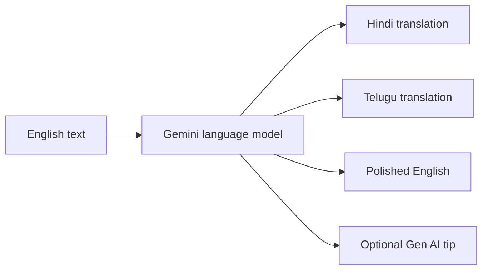

# 🌍 Anuvada AI

**Breaking language barriers with context-aware AI.**

Anuvada AI is a multilingual communication project focused on making digital content easier to understand in the languages people use every day. The current app accepts English text and uses Google Gemini to return Hindi and Telugu translations, polished English, and a short generative AI tip when relevant.

> Anuvada AI aims to help people understand and share content across languages while preserving meaning and context.

## The Problem

Much of the world's digital content is available in only a handful of languages. This can make it harder for students to learn, for businesses to serve customers, and for people to access public information in a language they understand.

## How It Works

The current workflow is intentionally simple: enter English text, request a conversion, and review the language output.



The model is instructed to consider meaning and context rather than translate word by word. The app displays each result in a history panel for the current session.

## Current Features

- English text input
- Hindi and Telugu translations
- Corrected or improved English
- Optional short generative AI tip
- In-session history of recent conversions

## Roadmap

The following ideas describe the broader product vision and are not implemented in the current app:

- Automatic source-language and script detection
- More language pairs, including Kannada, Tamil, Malayalam, French, German, and Spanish
- PDF, DOCX, and presentation translation with formatting preservation
- Voice input and spoken translations
- Website and conversation translation
- Translation quality checks for grammar, tone, consistency, and context
- Real-time multilingual communication

## Technology

**In the current app:**

- Python
- Streamlit
- Google Gemini API

**Possible future extensions:**

- React or FastAPI services
- PostgreSQL or MongoDB
- Azure or AWS deployment
- Additional translation models and NLP services

## Run Locally

1. Use Python and install the project dependencies:

   ```bash
   pip install -r requirements.txt
   ```

2. Create `.streamlit/secrets.toml` and add your Gemini API key:

   ```toml
   GEMINI_API_KEY = "your-gemini-api-key"
   ```

3. Start the app:

   ```bash
   streamlit run app.py
   ```

Keep the API key private. `.streamlit/secrets.toml` is excluded by `.gitignore`; do not commit credentials.

## Potential Use Cases

- **Education:** make learning materials more accessible in local languages.
- **Healthcare:** help people understand translated health information.
- **Public services:** make information easier for communities to access.
- **Customer support:** communicate with customers across language differences.
- **Enterprise teams:** support multilingual internal communication.

These are intended use cases; the current prototype provides text conversion only and should not be used as a substitute for professional translation in high-stakes situations.

## Intended Impact

- Reduce language barriers
- Improve access to digital information
- Support learning in native languages
- Help organizations reach broader audiences
- Enable more inclusive communication

## One-Line Pitch

> Anuvada AI is an intelligent multilingual communication platform that uses AI to understand, translate, and deliver content across languages while preserving context, meaning, and user experience.